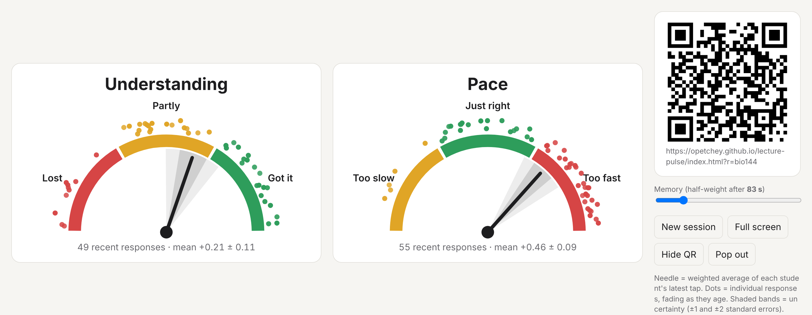
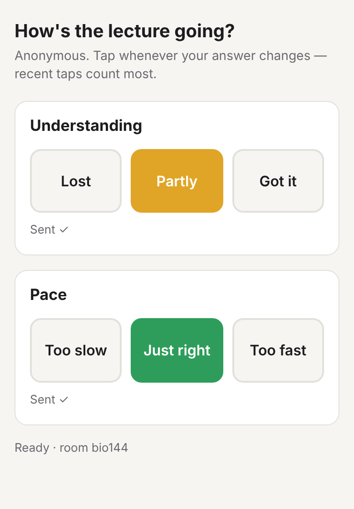
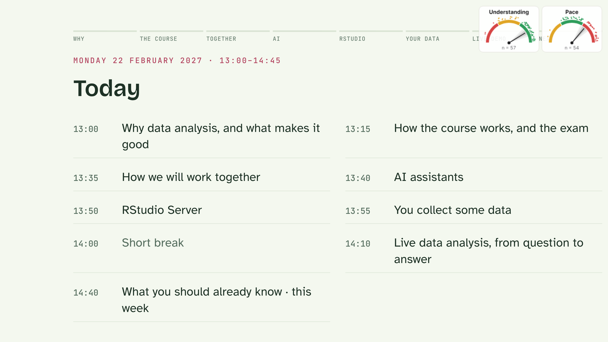

# Lecture Pulse

**See how your students are doing during a lecture, live and anonymously.**

Students scan a QR code with their phone and tap one of three buttons for each of two questions:

- **Understanding:** Lost / Partly / Got it
- **Pace:** Too slow / Just right / Too fast

Your screen shows two dials. The needle shows the room's average, with recent taps counting most. A shaded band shows how sure that average is, and each student's tap appears as a dot that slowly fades. Students need no app and no login.

Made by Owen Petchey (University of Zurich) for the course BIO144 *Data Analysis in Biology*.

**Website, with an easy link maker:** https://opetchey.github.io/lecture-pulse/

| The lecturer's dials (simulated class) | What students see |
|---|---|
|  |  |



*The dials can also sit in a corner of HTML slides, or float in a small window over PowerPoint or Keynote.*

---

## 1. Use it in your lectures, nothing to install

You can use my copy straight away. It is free, and several lecturers can use it at the same time without seeing each other's students.

### Step 1: choose a room name

Your "room" keeps your students' taps separate from everyone else's. Make the name unique and a bit hard to guess, for example:

`miller-ecology-2027`

Use only letters, numbers and dashes, no spaces.

### Step 2: open your dials

Type this address into your web browser, with your own room name at the end:

**`https://opetchey.github.io/lecture-pulse/present.html?r=miller-ecology-2027`**

Bookmark it so you don't need to type it again.

### Step 3: show the QR code to your students

The page shows a QR code on the right. Put it on the projector. Students scan it with their phone camera, tap, and that's it. They can tap again whenever their answer changes.

Before your first lecture, try it once with your own phone. Tap a button and watch a dot appear.

### Optional extras

- **A small window that floats over your slides.** In Chrome or Edge, click **Pop out** on the dials page. This opens a small window that stays on top of PowerPoint, Keynote, a PDF or anything else. Drag it to a corner. Leave the original browser tab open in the background.
- **Memory slider.** This sets how quickly old taps fade. The default is about 1½ minutes. Move it right if your students tap rarely, and left for a quicker response.
- **Hide QR** once everyone has scanned it, and **Full screen** for the projector.
- **New session** starts again with an empty room and a new QR code. You rarely need it, because old taps fade away by themselves.
- **HTML slides.** If you make your slides as HTML pages, see section 5 for how to put small dials in a corner of every slide.

### A sentence you could say to students

*"This is anonymous. No names are collected. Tap whenever you feel lost or I'm going too fast; recent taps count most."*

---

## 2. Like it? Please tell me!

If you use Lecture Pulse, I would love to hear from you, even just a line saying which course you used it in. Ideas and complaints are welcome too.

**Contact:** Owen Petchey, University of Zurich, via my [university web page](https://www.ieu.uzh.ch/en/staff/member/petchey_owen.html) or [LinkedIn](https://www.linkedin.com/in/owen-petchey-a31104120/).

If lots of people use my copy at once, it might hit the free plan's limits. That would be a lovely problem to have, so please don't hold back. If you plan to use it heavily, e.g. in many large lectures, you may prefer your own copy (section 3), which is completely independent of mine.

---

## 3. Make your own copy (about 30–45 minutes, no programming)

With your own copy, nothing depends on mine. You'll create two free accounts and copy-and-paste a few things. Take it slowly; every step is a click or a paste.

### A. Copy the app on GitHub (5 minutes)

1. Create a free account at **github.com** if you don't have one, and sign in.
2. Go to **https://github.com/opetchey/lecture-pulse**.
3. Click **Fork** near the top right, then **Create fork**. You now have your own copy, at `github.com/YOUR-NAME/lecture-pulse`.

### B. Create the free database on Firebase (15 minutes)

Firebase is a free Google service that passes the taps from phones to your dials.

1. Go to **https://console.firebase.google.com** and sign in with a Google account.
2. Click **Create a project** (or **Add project**). Give it any name, e.g. `lecture-pulse`. You can switch off Google Analytics. Click through to the end.
3. **Create the database.** In the menu on the left, find **Realtime Database**. It may be inside a group called **Build**; if you can't see it, click **All products**. Then:
   - Click **Create database**.
   - Choose the location **Belgium (europe-west1)**, or one near you.
   - Choose **Start in locked mode**, then click **Enable**.
4. **Paste the safety rules.** Still in Realtime Database, open the **Rules** tab.
   - Delete everything in the box.
   - Open the file `database.rules.json` in your GitHub copy, copy all of it, and paste it into the box.
   - Click **Publish**.
5. **Allow anonymous sign-in.** In the left menu, find **Authentication**, and click **Get started** if you see it. Open the **Sign-in method** tab, click **Anonymous**, switch it on, and click **Save**.
6. **Get your app's settings.**
   - Click the **gear icon** (top left), then **Project settings**.
   - Scroll down to **Your apps** and click the **`</>`** (Web) icon.
   - Type any nickname, leave "Firebase Hosting" unticked, and click **Register app**.
   - Firebase shows some code containing `const firebaseConfig = { ... }`. Copy everything from the `{` to the matching `}`.

### C. Put your settings into your copy (5 minutes)

1. On GitHub, in your copy, click the file **`config.js`**, then the **pencil icon** (Edit) at the top right of the file.
2. Find the line that starts `export const firebaseConfig = {`. Replace everything from that `{` down to its matching `};` with what you copied from Firebase. Keep `export const firebaseConfig =` at the start.
3. **Check that there is a line starting `databaseURL:`.** If it's missing, copy the address shown at the top of the **Data** tab in Realtime Database (it ends in `firebasedatabase.app`). Then add a line like this:
   `databaseURL: "https://your-project-default-rtdb.europe-west1.firebasedatabase.app",`
4. Optionally, change `DEFAULT_ROOM` to your own room name.
5. Click **Commit changes**, and then **Commit changes** again.

GitHub may later warn you about a "Google API Key" in `config.js`. That's expected: this key is designed to be public, and your data is protected by the rules you pasted in step B4. You can close the alert as "False positive".

### D. Put your copy online (5 minutes)

1. In your GitHub copy, click **Settings** (top), then **Pages** (left).
2. Under "Branch", choose **main** and **/ (root)**, then click **Save**.
3. Wait a minute and refresh. GitHub shows your address, like `https://YOUR-NAME.github.io/lecture-pulse/`.

### E. Use it

Open **`https://YOUR-NAME.github.io/lecture-pulse/present.html`** and continue as in section 1.

If something doesn't work, the page usually shows an error message:

| Message | What to do |
|---|---|
| `admin-restricted-operation` | Anonymous sign-in isn't on (step B5) |
| `PERMISSION_DENIED`, or taps never arrive | The rules weren't published (step B4) |
| "Can't determine Firebase Database URL" | The `databaseURL` line is missing (step C3) |
| Yellow "Local test mode" badge | Your settings aren't in `config.js` yet (section C) |
| Changes don't show | Wait up to 10 minutes, then reload |

---

## 4. Good to know

- **Privacy.** Each phone gets a random anonymous ID. No names, email addresses or other personal details are collected. The data is stored by Google Firebase in the EU region you chose.
- **Cost.** It's free on Firebase's free "Spark" plan, with no payment card needed. The phones only connect for the moment they send a tap, so hundreds of students can use it at once.
- **Other wording, colours or questions.** In your own copy, edit the `GAUGES` section of `config.js`.

---

## 5. More details (for the curious)

### Small dials in a corner of HTML slides

Add this line just before `</body>` in the version of an HTML slide deck that you present from:

```html
<script src="https://opetchey.github.io/lecture-pulse/pulse-widget.js" data-room="your-room-name"></script>
```

If you made your own copy, use your own address. Press **G** to hide or show the dials. The comments at the top of `pulse-widget.js` list the options: corner, width, toggle key, start hidden.

### How the numbers work

Each phone counts only through its **latest** tap per question, scored −1, 0 or +1. Phones can tap at most once every 4 seconds, and the database rules allow at most one write every 3 seconds. A tap made *t* seconds ago gets weight *w* = exp(−*t*/τ). The memory slider sets τ, shown as the half-weight time (default ≈ 83 s).

- **Mean:** *m* = Σ*wx* / (Σ*w* + *k*). Here *k* = 0.5 is a weak pull towards the middle, so the needle drifts back to centre when nobody has tapped for a while.
- **Spread:** the weighted variance *s*² around *m*.
- **Effective sample size:** *n*ₑ = (Σ*w*)² / Σ*w*². This falls as taps age.
- **Uncertainty:** standard error = *s* / √*n*ₑ. The shaded bands show ±1 and ±2 SE. They are narrow when many students agree recently, and wide when opinions are split or few people tap.
- **Dots:** one per phone, placed in its answer's zone. Each dot's transparency equals that tap's weight *w*.

### Testing on your own computer

In the downloaded folder, run `python3 -m http.server 8000` in a Terminal, then open:

- `http://localhost:8000/present.html?demo`: 80 simulated students
- `http://localhost:8000/present.html?local` plus `http://localhost:8000/index.html?local` in other tabs of the same browser: be the students yourself

Mac users can double-click `start-test.command` instead.

### Files

| File | What it is |
|---|---|
| `about.html` | The information page (the site's front page) |
| `index.html` | The student page, with the buttons. Without `?r=` it shows the information page |
| `screenshots/` | Pictures used on the information page and in this README |
| `present.html` | The lecturer's dials. `?r=` sets the room; `?mini` gives a compact view |
| `pulse-widget.js` | Corner dials for HTML slides |
| `config.js` | Firebase settings, room name, questions and colours |
| `backend.js` | Talks to Firebase, and calculates the average and uncertainty |
| `database.rules.json` | Safety rules to paste into Firebase |
